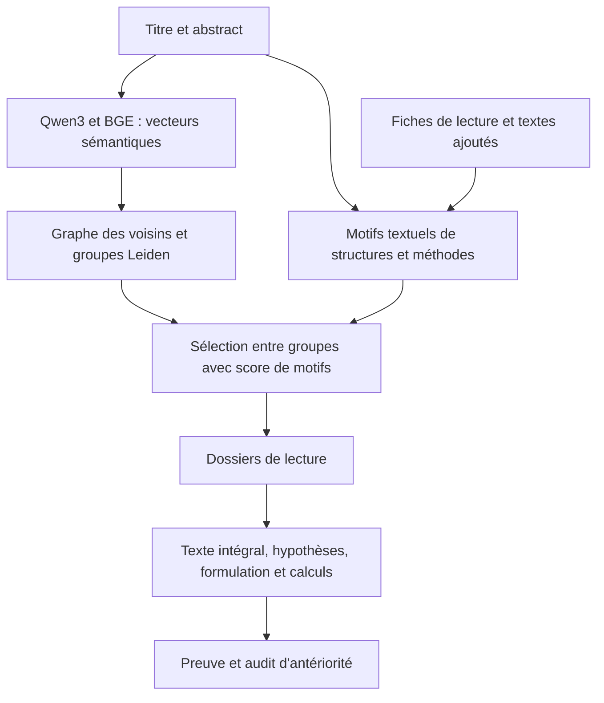

# Comment le rapprochement fonctionne réellement

## Deux étapes distinctes

Oui, **la carte de départ est construite avec des embeddings des titres et abstracts complets**. Mais le moteur local de rapprochement ajouté ici ne recalcule pas ces embeddings et ne lit pas leurs coordonnées pour classer les paires.

## La carte Qwen3/BGE existante

Selon `oqmresearch/abstracts/map/README.md` et les scripts de la carte : Qwen3-Embedding-0.6B et bge-large-en-v1.5 fournissent chacun un vecteur de 1 024 dimensions, normalisé ; les vecteurs sont concaténés. Un graphe des 15 plus proches voisins par similarité cosinus est partitionné par Leiden : 155 groupes fins et 19 zones plus larges. UMAP produit l'image 2D, utilisée pour afficher la carte.

Le regroupement ne repose pas sur une lecture complète des preuves. Deux articles peuvent être proches parce qu'ils partagent un sujet ou une manière d'écrire. Les positions 2D UMAP ne sont pas utilisées comme distances dans le moteur de découverte.

## Le moteur ajouté ici

`abstracts/discovery/engine.py` charge les identifiants de groupe/zone depuis `papers-map.jsonl.gz`, les titres/abstracts du corpus et les annotations de lecture. Un dictionnaire de motifs recherche des structures, méthodes, objets et autres indices. Chaque occurrence conserve un extrait exact et l'empreinte de sa source. Des fiches de résultats rédigées après lecture peuvent ajouter des structures et méthodes plus précises. Les textes intégraux importés peuvent aussi fournir des motifs.

L'index inversé permet de trouver les articles partageant un motif sans comparer toutes les paires du corpus. Des réservoirs et des ancres répartis entre les groupes bornent le coût. Pour garder une paire, la version exécutée exige notamment des groupes différents, des thèmes primaires différents quand ils sont connus, et au moins deux familles de motifs communs, dont une structure. Plusieurs variantes très proches comme SDP/dualité/convexité sont regroupées en familles pour éviter de compter plusieurs fois la même idée.

Le score de base est :

\[
S=W\,[0.65+0.2D+0.15(1-J)]+0.5C.
\]

Ici W additionne, par famille, le poids du motif partagé le plus fort : rareté `log(1+N/n_motif)` et facteur 1,3 pour une méthode. D vaut 1 pour deux zones distinctes, 0,55 pour deux groupes d'une même zone, et 0,35 si la séparation est inconnue. J est le Jaccard des indices d'objets. C compte les articles de la paire qui possèdent des fiches de résultats actuelles, de zéro à deux. Le score est multiplié par 0,7 si les titres partagent un terme rare, et par 0,8 si au moins un article n'a pas le statut `include`.

Le programme conserve au plus quatre voisins par ancre, déduplique, puis limite les répétitions d'articles et de familles. Ce sont des choix heuristiques de diversité, pas des constantes mathématiquement optimales. Le nombre 24 864 désigne les comparaisons qui passent les filtres avant calcul du score, éventuellement dans les deux orientations, pas toutes les paires possibles.

## Ce que cela sait et ne sait pas conclure

Le moteur repère une analogie à examiner. Il ne sait pas, à partir de ces motifs, que deux « dualités » sont compatibles, que les hypothèses d'un théorème se transportent, ou qu'une question est nouvelle. Une mention peut venir de l'introduction, des limites ou des références, et non d'un résultat démontré dans l'article.

La piste KD est passée par un dossier thématique existant et une lecture complémentaire. Une recherche numérique a ensuite proposé un témoin ; des calculs exacts et une preuve écrite ont établi la séparation. **Les embeddings ont orienté l'exploration du corpus ; ils n'ont pas démontré le résultat.**

La version actuelle peut même rater des prolongements féconds dans un même groupe, puisqu'elle les exclut pour privilégier les ponts entre domaines. Une amélioration possible serait de séparer la recherche de ponts de la recherche de lacunes au sein d'un domaine. Elle n'a pas été implémentée dans cette passe.
